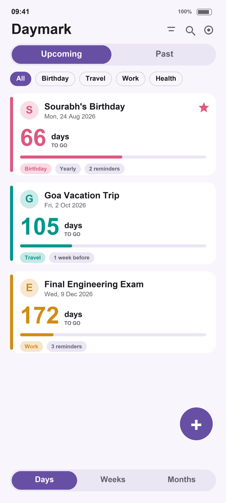
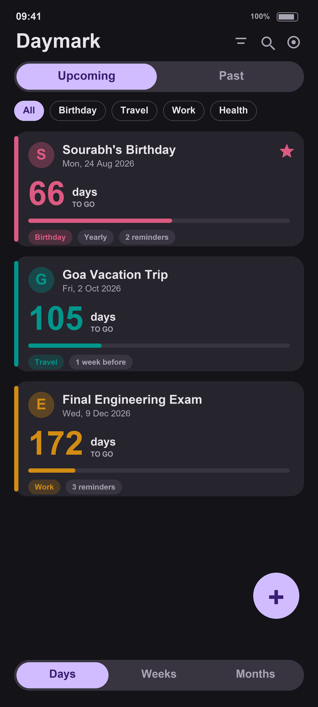
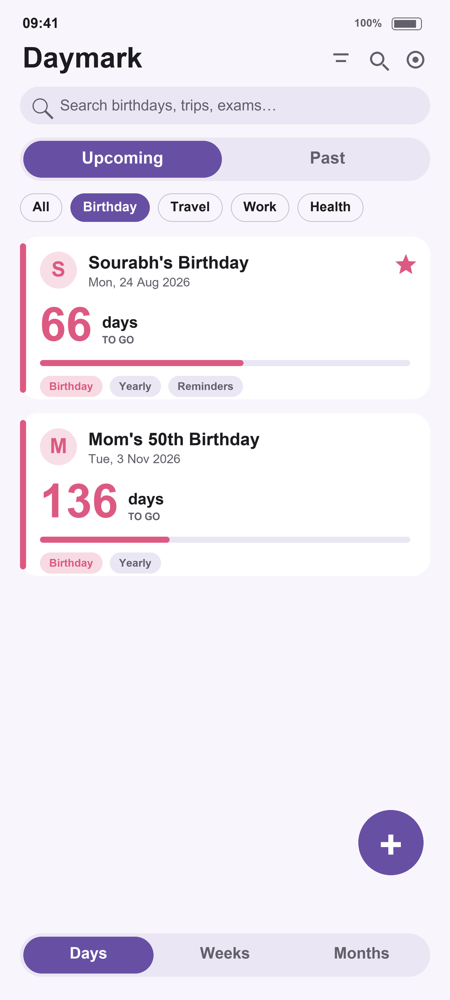
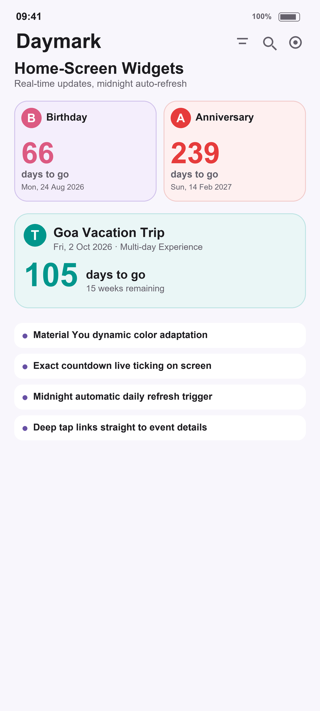

<div align="center">

# 📅 Daymark

**Count down to the moments that matter — and count up from the ones you'll never forget.**

A beautiful, modern **Material You (M3)** countdown & count-up application for Android.

`com.sourabhkulkarni.countdate` · v1.0.1 · by **Sourabh Kulkarni**

</div>

---

## 📖 Introduction

**Daymark** is an intuitive, privacy-friendly event tracker designed to help you celebrate upcoming milestones and cherish meaningful memories from the past. Whether it's birthdays, anniversaries, vacations, career milestones, exams, or habits, Daymark delivers a clean, fluid, and customizable experience directly on your device with no accounts, ads, or tracking.

---

## 📱 Screenshots & Video Tour

<div align="center">
  
  
  
  

  <br/><br/>
  
  🎬 **Watch the full video tour:** [**Daymark_App_Tour.mp4**](App_Screenshots/Daymark_App_Tour.mp4)
</div>

---

## ✨ Features & Enhancements

### ⏳ Flexible Countdown & Count-Up
- **Dual Mode:** Count down to future moments or count up from past milestones.
- **Uncapped Date Range:** Pick any date from **1900 up to 100+ years into the future** (no arbitrary caps).
- **Exact Time Precision:** Select down to the minute and watch live ticking countdowns.
- **Multi-Day & Experience Events:** Optional end date calculation and inclusive day counting (+1 day).
- **Multiple Time Views:** View counts in Days, Weeks, Months, or relative breakdown (Years / Months / Days).

### 🎨 Material You (M3) Design & Personalization
- **Modern Material Design 3:** Fluid animations, rounded surface cards, and dynamic purple theming.
- **Full Dark & Light Theme:** Automatic system theme following or manual toggle.
- **Per-Event Customization:** Assign custom accent colors and emoji icons to every event card.
- **Card Progress Bar:** Visual progress representation towards your upcoming target dates.
- **Full-Screen Photo Viewer:** Attached event imagery with smooth pinch-to-zoom support.

### 🔁 Recurrence & Smart Anniversaries
- **Comprehensive Recurrence Cycles:** Supports **Hourly, Daily, Weekly, Monthly, and Yearly (Anniversary)** repeats.
- **Smart Auto-Rolling:** Completed recurring events automatically roll over to the next occurrence instead of going negative.

### 🔔 Reminders & Notifications
- **Reliable Local Notifications:** Scheduled right on your device without needing remote servers.
- **Custom Alert Timings:** Get notified on the day, or 1 hour, 1 day, 3 days, 1 week, 2 weeks, or 1 month before the event.

### 📂 Organization & Management
- **Pin to Top:** Keep your most important priorities anchored at the top of the list.
- **Built-in & Custom Categories:** Comes with 6 preconfigured categories (General, Birthday, Anniversary, Travel, Work, Health) plus the freedom to create unlimited custom categories on the fly.
- **Fast Filter & Search:** Real-time search, category filters, and sorting by Soonest, Newest, or Name (A–Z).
- **Gesture Navigation:** Smooth left/right swiping between Upcoming and Past events.

### 📱 Android Home-Screen Widget
- **Interactive Material You Widget:** Glance at your top counts directly from your home screen.
- **Midnight Auto-Refresh & Real-Time Sync:** Automatically stays up to date when days change or events are edited.
- **Customizable Appearance:** Configure widget background transparency, text colors, and target items.

### 🔒 Privacy, Offline & Data Safety
- **100% Offline & Private:** Your data never leaves your device. No analytics, no ads, no trackers.
- **Full Backup & Restore:** Export your complete event collection to JSON and restore or transfer to other devices anytime.

---

## 🛠 Tech Stack

| Layer | Technology |
|---|---|
| **UI Framework** | Ionic 8 + React 18 (Material Design mode) |
| **Language & Bundler** | TypeScript + Vite |
| **Native Runtime** | Capacitor 8 (Android) |
| **Local Storage** | Capacitor Preferences (Typed data layer in `src/data/`) |
| **Notifications** | Capacitor Local Notifications |
| **Android Target** | Android 6.0 (API 23) → Android 16/17 (API 36) |

---

## 📂 Project Structure

```
src/
  components/    # EventCard, filters, and reusable UI components
  data/          # Typed data layer — models, storage migration, date math, reminders
  i18n/          # Internationalization & localized strings
  lib/           # Widget synchronization & helper utilities
  pages/         # Home, Add/Edit, Manage, Categories, Settings, About, Backup
  theme/         # Material You CSS variables & theme tokens
android/         # Native Android Capacitor project, Java source & app widget
```

---

## 🚀 How to Run Locally

### Prerequisites
- **Node.js ≥ 22**
- **JDK 21**
- **Android SDK** (with platform-tools & emulator/device)

### 1. Install dependencies
```bash
npm install
```

### 2. Run in browser (Live Development)
```bash
npm run dev
```

### 3. Build web bundle & sync to Android
```bash
npx vite build
npx cap sync android
```

### 4. Build Android Debug APK
```bash
cd android
./gradlew assembleDebug
```
The debug APK is generated at:
```
android/app/build/outputs/apk/debug/app-debug.apk
```

For release builds, version bumping, and signing instructions, see **[BUILD_AND_DEPLOY.md](BUILD_AND_DEPLOY.md)**.

---

## 💬 Feedback & Support

Found an issue or have a feature idea?
- Use the in-app **About → Feedback** options
- Email: **developer.sourabhk@gmail.com**

---

## 👤 Author

**Sourabh Kulkarni**  
- Email: developer.sourabhk@gmail.com  
- GitHub: [@SourabhKulkarni19](https://github.com/SourabhKulkarni19)

---

## 🙏 Acknowledgements & Attribution

Daymark was inspired by and built on top of the open-source project [**countdateapp**](https://github.com/sk5s/countdateapp) originally created by [**sk5s**](https://github.com/sk5s), released under the [MIT License](LICENSE).

A sincere thank you to **sk5s** for the foundational idea and open-source contribution that sparked the development and evolution of Daymark.

